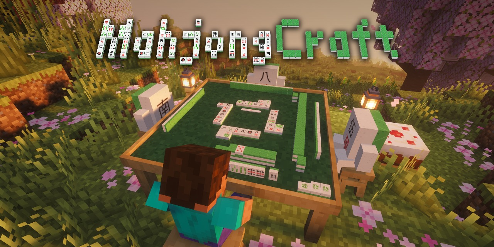

<p align="center"></p>

# Minecraft Platform

## Purpose

The Minecraft adapter turns MahjongCraft flow and domain state into a playable mod.

## Requirements

Install the mod on both the server and the clients.

### Fabric

<p>
<a href="https://fabricmc.net/"></a>&nbsp;&nbsp;
<a href="https://github.com/FabricMC/fabric-api"></a>&nbsp;&nbsp;
<a href="https://github.com/FabricMC/fabric-language-kotlin"></a>
</p>

Requires [Fabric API](https://github.com/FabricMC/fabric-api) and
[Fabric Language Kotlin](https://github.com/FabricMC/fabric-language-kotlin).

### Forge and NeoForge

<p>
<a href="https://files.minecraftforge.net/"></a>&nbsp;&nbsp;
<a href="https://neoforged.net/"></a>
</p>

Requires [Kotlin for Forge](https://github.com/thedarkcolour/KotlinForForge).

## Layers

| Layer | Responsibility |
| --- | --- |
| [Cross-version common](common/README.md) | Minecraft-facing contracts, assets, configuration, layout, and presentation models shared across supported versions. |
| [Shared Minecraft mod sources](mod/README.md) | Code, resources and tests that are the same for every supported Minecraft version; each version's mod module compiles them. |
| [Minecraft 1.20.1 mod](v1.20.1/mod/README.md) | Minecraft 1.20.1 adapters and version-specific files, compiled with the shared sources against vanilla Minecraft. |
| [Minecraft 1.21.1 mod](v1.21.1/mod/README.md) | Minecraft 1.21.1 adapters and version-specific files, compiled with the shared sources against vanilla Minecraft. |
| [Shared Fabric sources](fabric/README.md) | Fabric runtime integration, rendering, commands and persistence that are the same for every supported Minecraft version; each version's Fabric module compiles them. |
| [Minecraft 1.20.1 Fabric](v1.20.1/fabric/README.md) | Fabric 1.20.1 networking and metadata, compiled with the shared Fabric sources, and final mod packaging. |
| [Minecraft 1.21.1 Fabric](v1.21.1/fabric/README.md) | Fabric 1.21.1 networking and metadata, compiled with the shared Fabric sources, and final mod packaging. |
| [Minecraft 1.20.1 Forge](v1.20.1/forge/README.md) | Forge runtime integration, rendering, commands, persistence, and final mod packaging. |
| [Minecraft 1.21.1 NeoForge](v1.21.1/neoforge/README.md) | NeoForge runtime integration, rendering, commands, persistence, and final mod packaging. |
| [Cross-version common debug tools](common-debug/README.md) | Development-only debug code and resources that do not call Minecraft, such as debug rules, scenario data and stress test statistics. |
| [Shared Minecraft mod debug tools](mod-debug/README.md) | Development-only debug commands, scenarios, stress tests and automated tests that are the same for every supported Minecraft version. |
| [Minecraft 1.20.1 mod debug tools](v1.20.1/mod-debug/README.md) | Minecraft 1.20.1 debug code, such as the automated test's mixins, compiled with the shared debug tools against vanilla Minecraft. |
| [Minecraft 1.21.1 mod debug tools](v1.21.1/mod-debug/README.md) | Minecraft 1.21.1 debug code, compiled with the shared debug tools against vanilla Minecraft. |
| [Shared Fabric debug sources](fabric-debug/README.md) | Fabric entrypoints for the debug tools that are the same for every supported Minecraft version. |
| [Minecraft 1.20.1 Fabric debug tools](v1.20.1/fabric-debug/README.md) | Fabric 1.20.1 debug tools module, loaded into development runs and never packaged. |
| [Minecraft 1.21.1 Fabric debug tools](v1.21.1/fabric-debug/README.md) | Fabric 1.21.1 debug tools module, loaded into development runs and never packaged. |
| [Minecraft 1.20.1 Forge debug tools](v1.20.1/forge-debug/README.md) | Forge entry points for the debug tools, loaded into development runs and never packaged. |
| [Minecraft 1.21.1 NeoForge debug tools](v1.21.1/neoforge-debug/README.md) | NeoForge entry points for the debug tools, loaded into development runs and never packaged. |

## Target

The catalog-backed targets are `minecraft-v1.20.1-fabric`, `minecraft-v1.20.1-forge`,
`minecraft-v1.21.1-fabric` and `minecraft-v1.21.1-neoforge`.
Cross-version code uses the core Java policy; version and loader modules use the Java policy
declared by the selected target.

Run commands from the repository root; quote the target property, including on PowerShell:

```shell
./gradlew build "-PmahjongcraftTarget=minecraft-v1.20.1-fabric"
./gradlew detektAll "-PmahjongcraftTarget=minecraft-v1.20.1-fabric"
```

Each target loads the cross-version common layer, its Minecraft version's mod module, one loader adapter
and their debug tools. It does not validate other Minecraft versions or loaders. Several targets can be
selected together, as described in [Build](../../docs/contributing/build.md).

## Boundaries

Version-neutral Minecraft behavior belongs in `common`.
Code that calls a specific Minecraft version belongs in that version's mod module, and loader APIs
belong only in the corresponding loader module. Rules, command validation, and authoritative changes
remain in the core logic and Flow layers.

Minecraft presentation extensions and game-event subscriptions are separate surfaces:
extensions register platform mappings during initialization, while event listeners observe
committed game results. Event and seating API compatibility is limited to the scope in
[Public API Compatibility](../../docs/contributing/extensions-and-registries.md#public-api-compatibility), not by every public class in the Minecraft modules.

See [Build](../../docs/contributing/build.md) for selecting and building a target, and
[Minecraft Build](../../docs/contributing/minecraft-build.md) for build rules specific to these modules.
